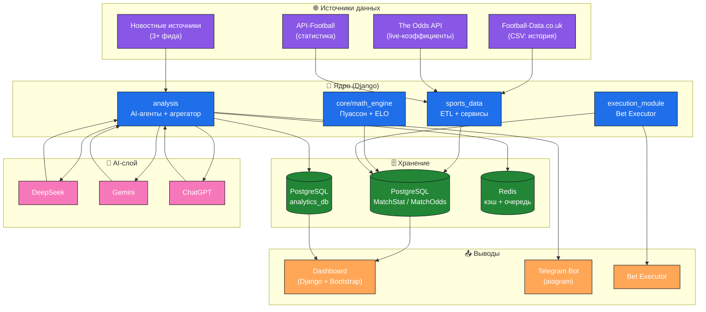

<!-- ═══════════════════════════════════════════════════════════════ -->
<!--                    SPORTS TRADING BOT — README                 -->
<!-- ═══════════════════════════════════════════════════════════════ -->

<div align="center">


### 🧠 Интеллектуальная платформа проактивного беттинга

**Гибридная система: математический движок + мультиагентный AI + компьютерное зрение**

[](https://python.org)
[](https://djangoproject.com)
[](https://postgresql.org)
[](https://docker.com)
[](https://redis.io)

[](https://deepseek.com)
[](https://ai.google.dev)
[](https://openai.com)
[](https://ultralytics.com)

[](.)
[](./LICENSE)
[](./docs)

---

[📚 Документация](./docs) · [🏗 Архитектура](#-архитектура) · [⚡ Quick Start](#-quick-start) · [🧠 Модули](#-аналитические-модули) · [🗺 Roadmap](#-roadmap)

</div>

---

## 🎯 О проекте

**Sports Trading Bot** — это **автоматизированная система** для поиска **математически выгодных ставок** (Value Betting) на основе:

- 📊 **Исторических данных** футбольных матчей,
- 🧮 **Собственного математического движка** (Пуассон + Келли),
- 🤖 **Мультиагентного AI** (DeepSeek + Gemini + ChatGPT),
- 📰 **Новостного анализа** (контекст, травмы, мотивация),
- 👁 **Компьютерного зрения** (YOLO для live-анализа) *(Roadmap)*.

> 💡 **Философия проекта:** не «ещё один парсер коэффициентов», а **гибридная система**, которая отличает **ложные движения рынка** от **реальных возможностей**, давая фору в **1–3 секунды**.

---

## 🏗 Архитектура

### Высокоуровневая схема



### Компоненты системы

| Слой | Компонент | Технология | Назначение |
|:---:|---|---|---|
| 🌐 | **Источники** | CSV · REST API · RSS | Сбор сырых данных |
| 🧠 | **MathEngine** | Python + NumPy | Пуассон + скользящее окно |
| 🤖 | **AI Agents** | DeepSeek + Gemini + ChatGPT | Коллективные прогнозы |
| 📰 | **News Analyzer** | LLM + NLP | Контекст и тональность |
| 🎯 | **Aggregator** | Взвешенное голосование | Итоговое решение |
| 🗄 | **Storage** | PostgreSQL (Multi-DB) + Redis | Данные + кэш |
| 📊 | **Dashboard** | Django + Bootstrap | Визуализация |
| 📨 | **Notifier** | aiogram (Telegram) | Уведомления |
| 🐳 | **Infra** | Docker Compose | Оркестрация |

---

## ⚡ Quick Start

### Предварительные требования

- **Docker** + **Docker Compose**
- **Python 3.10+** (для локальной разработки)
- API-ключи: **DeepSeek**, **Gemini**, **OpenAI**, **The Odds API**

### Запуск за 3 шага

```bash
# 1. Клонируем репозиторий
git clone https://github.com/your-username/sports-trading-bot.git
cd sports-trading-bot

# 2. Настраиваем окружение
cp .env.example .env
# → отредактируйте .env: DATABASE_URL, DEEPSEEK_API_KEY, GEMINI_API_KEY, OPENAI_API_KEY

# 3. Запускаем весь стек одной командой
docker-compose up -d --build

# Проверяем статус
docker-compose ps
```

### Проверка работы

| Сервис | URL | Что показывает |
|---|---|---|
| 🖥 **Web Dashboard** | http://localhost:8000/dashboard/ | Таблица матчей с value |
| 🤖 **Analytics API** | http://localhost:8001/api/analytics/ | AI-прогнозы |
| ⚙️ **Django Admin** | http://localhost:8000/admin/ | Управление данными |
| ❤️ **Health Check** | http://localhost:8001/health/ | Статус модуля |

### Основные команды

```bash
# Загрузка истории матчей из CSV
docker-compose exec web python manage.py import_csv mls.csv \
    --league_name="MLS" --api_id=253

# Обновление коэффициентов из The Odds API
docker-compose exec web python manage.py update_odds \
    --league=soccer_usa_mls

# Анализ матча через AI-агентов
docker-compose exec analytics python manage.py analyze --match-id=12345

# Запуск Telegram-бота (уведомления о валуях)
docker-compose exec executor python manage.py run_bot
```

---

## 🧠 Аналитические модули

Проект использует **три независимых аналитических слоя**, результаты которых **агрегируются** в итоговый прогноз.

### 1️⃣ MathEngine — математическая модель

<details>
<summary><b>📖 Показать детали</b></summary>

**Метод:** распределение Пуассона + скользящее окно + ELO.

```text
λ_home = attack_home × defence_away × HOME_ADVANTAGE (1.1)
λ_away = attack_away × defence_home

P(i, j) = Pois(i, λ_home) × Pois(j, λ_away)
```

**Что даёт:**
- P(П1), P(X), P(П2)
- P(Over 2.5), P(Under 2.5)
- топ-5 точных счётов

**Value Betting:**
```text
Value = (P_bot × Odds_bookie) − 1
```

→ Подробнее: [`docs/14-math-engine-explained.md`](./docs/14-math-engine-explained.md)

</details>

### 2️⃣ AI Agents — коллективный прогноз

<details>
<summary><b>📖 Показать детали</b></summary>

**Логика:** 3 LLM-модели параллельно анализируют матч по единому промту, затем **голосование** и **взвешивание**.

| Агент | Модель | Timeout | Особенность |
|---|---|---|---|
| DeepSeek | `deepseek-chat` | 30с | Хорош в математике |
| Gemini | `gemini-2.0-flash` | 35с | Быстрый + дешёвый |
| ChatGPT | `gpt-4o-mini` | 25с | Лучший в контексте |

**Агрегация:**
- Усреднение вероятностей
- Проверка согласованности (`agreement`)
- Понижение уверенности при разногласиях

→ Подробнее: [`docs/13-ai-sports-analytics.md`](./docs/13-ai-sports-analytics.md)

</details>

### 3️⃣ News Noise — новостной контекст

<details>
<summary><b>📖 Показать детали</b></summary>

**Источники:** 3+ фида (ESPN, BBC Sport, Sport-Express).

**Что извлекается:**
- Травмы / дисквалификации
- Мотивация (борьба за место)
- Погода, судейство
- Общий тон статьи

**Формат:** JSON с bias на вероятности исходов.

→ Подробнее: [`docs/13-ai-sports-analytics.md`](./docs/13-ai-sports-analytics.md)

</details>

### 🔗 Aggregator — итоговое решение

<details>
<summary><b>📖 Показать детали</b></summary>

**Веса по умолчанию:**

| Слой | Вес |
|---|---|
| 🧮 MathEngine | **45%** |
| 🤖 AI Agents | **35%** |
| 📰 News Noise | **20%** |

**Финальная уверенность:**
```text
confidence = weighted_avg(confidences) × agreement_factor
```

где `agreement_factor` ∈ [0.6, 1.0] в зависимости от согласия слоёв.

→ Подробнее: [`docs/15-analytics-module-full.md`](./docs/15-analytics-module-full.md)

</details>

---

## 📚 Документация

**16 подробных кейсов** — от архитектуры до тестов. Читайте по порядку или выборочно.

### 🏗 Архитектура и инфраструктура

| # | Документ | О чём |
|:---:|---|---|
| **00** | [📌 Кейс: Sports Trading Bot](./docs/00-case-sports-trading-bot.md) | Общий обзор проекта |
| **01** | [🏗 Архитектура торгового бота](./docs/01-architecture.md) | Структура, слои, разделение |
| **02** | [📦 Система сбора данных](./docs/02-data-collection.md) | Docker, PostgreSQL, ORM |
| **06** | [📈 Масштабирование update_odds](./docs/06-scalability.md) | Сервис-ориентированный подход |
| **08** | [🏛 Разделение ответственности](./docs/08-separation-of-concerns.md) | StatsService + OddsService |
| **09** | [📋 Инициализация «Статики»](./docs/09-static-initialization.md) | ETL, CSV, 6034 матча |

### 💹 Value Betting и математика

| # | Документ | О чём |
|:---:|---|---|
| **03** | [💹 Анализ валуйных ставок](./docs/03-value-betting.md) | Value, Kelly, Roadmap |
| **10** | [💹 Автоматизированный поиск валуёв](./docs/10-value-betting-impl.md) | TEAM_MAP, MathEngine |
| **14** | [🧮 Как работает MathEngine](./docs/14-math-engine-explained.md) | От истории к прогнозу |

### 🤖 AI и уведомления

| # | Документ | О чём |
|:---:|---|---|
| **11** | [🤖 Telegram-уведомления](./docs/11-telegram-notifications.md) | aiogram, value > 0.3 |
| **13** | [🧠 AI Sports Analytics](./docs/13-ai-sports-analytics.md) | YOLO + MathEngine |
| **15** | [🧠 Модуль аналитики «Информатор»](./docs/15-analytics-module-full.md) | Полный цикл 3 LLM |

### 🖥 Dashboard и UI

| # | Документ | О чём |
|:---:|---|---|
| **04** | [🖥 Веб-интерфейс](./docs/04-web-dashboard.md) | Views, Templates, URLs |

### 🔄 Трансформация и тесты

| # | Документ | О чём |
|:---:|---|---|
| **05** | [💰 Система обновления коэффициентов](./docs/05-odds-update-system.md) | The Odds API, парсинг |
| **07** | [🚀 От хаоса к системе](./docs/07-transformation.md) | Фаза трансформации |
| **12** | [🧪 Отчёт по тестам](./docs/12-testing-report.md) | Что сделано / что нужно |

---

## 🛠 Технологический стек

<table>
<tr>
<td width="50%" valign="top">

### 🧠 Backend
- **Python 3.10+**
- **Django 4.x** + DRF
- **SQLAlchemy** (для миграций)
- **asyncio** + **httpx**
- **Pydantic** (валидация)

### 🗄 Data
- **PostgreSQL 15** (Multi-DB)
- **Redis 7** (кэш + очередь)
- **PgBouncer** (pooling)
- **Alembic** (миграции)

</td>
<td width="50%" valign="top">

### 🤖 AI / ML
- **DeepSeek API**
- **Google Gemini**
- **OpenAI ChatGPT**
- **YOLO v8** *(Roadmap)*
- **OpenCV** *(Roadmap)*

### 🐳 Infra
- **Docker** + **Compose**
- **Gunicorn**
- **Nginx** *(production)*
- **Celery** *(Roadmap)*

</td>
</tr>
</table>

---

## 🗺 Roadmap

```text
┌─────────────────────────────────────────────────────────────┐
│  ✅ MVP 2.0 — ТЕКУЩЕЕ СОСТОЯНИЕ                              │
│  ├─ ✅ Django + PostgreSQL + Docker                         │
│  ├─ ✅ MathEngine (Пуассон + Kelly)                         │
│  ├─ ✅ The Odds API + CSV импорт                            │
│  ├─ ✅ Telegram Bot с уведомлениями                         │
│  ├─ ✅ Multi-LLM аналитика (3 модели)                       │
│  └─ ✅ Dashboard с фильтрацией валуёв                       │
├─────────────────────────────────────────────────────────────┤
│  🚧 БЛИЖАЙШИЕ 3 МЕСЯЦА                                      │
│  ├─ ⏳ CLV-трекинг (Closing Line Value)                     │
│  ├─ ⏳ Insider Detection (детектор шарпов)                  │
│  ├─ ⏳ Optimism Tax detector                                │
│  ├─ ⏳ HT/FT стратегия                                      │
│  └─ ⏳ Celery + Redis queue                                 │
├─────────────────────────────────────────────────────────────┤
│  🔮 6-12 МЕСЯЦЕВ                                            │
│  ├─ ⏳ YOLO-интеграция (live-видеоанализ)                   │
│  ├─ ⏳ Bet Executor (автоматическое размещение)             │
│  ├─ ⏳ Веб-дашборд с графиками                              │
│  ├─ ⏳ Rules Engine (конфигурируемые пороги)                │
│  └─ ⏳ Расширение на другие виды спорта                     │
├─────────────────────────────────────────────────────────────┤
│  🌟 12+ МЕСЯЦЕВ                                             │
│  ├─ ⏳ Мультиагентность (политика, финансы, киберспорт)    │
│  ├─ ⏳ SaaS-платформа                                       │
│  ├─ ⏳ Мобильное приложение                                 │
│  └─ ⏳ Грант / акселератор (Сколково)                       │
└─────────────────────────────────────────────────────────────┘
```

---

## 📊 Статус проекта

| Метрика | Значение |
|---|---|
| **Версия** | MVP 2.0 |
| **Документов** | 16 |
| **Матчей в БД** | 6034+ |
| **AI-моделей** | 3 (DeepSeek, Gemini, ChatGPT) |
| **Docker-контейнеров** | 6+ |
| **Покрытие тестами** | Базовая |
| **Лицензия** | MIT |

---

## 🤝 Contributing

Мы приветствуем вклад в развитие проекта! Как помочь:

1. 🍴 **Fork** репозитория
2. 🌿 **Создайте ветку** (`git checkout -b feature/amazing-feature`)
3. ✍️ **Внесите изменения** с тестами
4. ✅ **Пройдите тесты** (`pytest`)
5. 📤 **Отправьте PR** с описанием

Подробнее: [`CONTRIBUTING.md`](./CONTRIBUTING.md)

---

## 📄 Лицензия

Этот проект распространяется под лицензией **MIT**.
Подробнее — в файле [LICENSE](./LICENSE).

[](./LICENSE)

---

## ⚠️ Disclaimer

> **Проект создан в образовательных и исследовательских целях.**
>
> Автор **не призывает** к участию в азартных играх и **не несёт ответственности**
> за любые финансовые потери, возникшие в результате использования данного
> программного обеспечения.
>
> Ставки связаны с риском. Играйте ответственно.

---

<div align="center">

### ⭐ Если проект оказался полезен — поставьте звезду!

**Сделано с ❤️ для сообщества аналитиков и разработчиков**

[](https://github.com/your-username/sports-trading-bot)
[](https://github.com/your-username/sports-trading-bot)
[](https://github.com/your-username/sports-trading-bot)

</div>

<!-- ═══════════════════════════════════════════════════════════════ -->
<!--                     END OF README                              -->
<!-- ═══════════════════════════════════════════════════════════════ -->